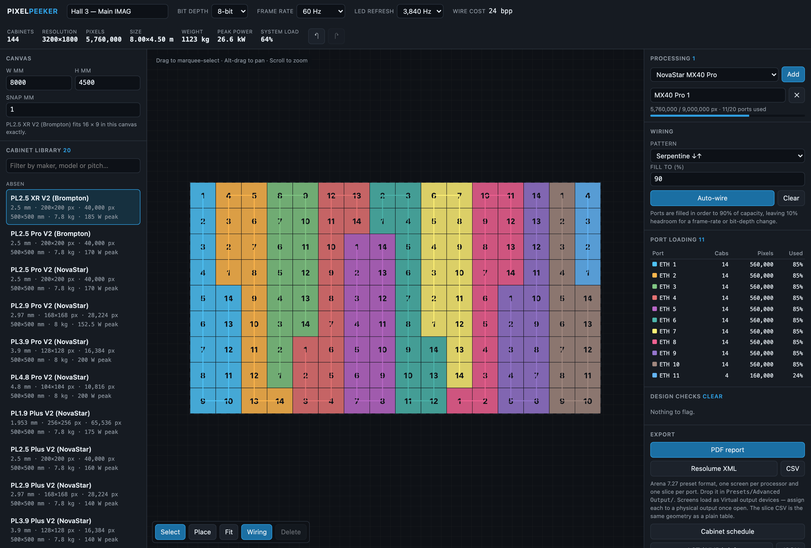

# Pixel Peeker user guide

Pixel Peeker is a browser tool for designing LED video walls: lay out cabinets on a canvas, add
processors, wire the ports, and find out whether it actually fits before you find out on site.

It runs entirely in the browser. There's no account, and nothing is uploaded, because there's no
server to upload it to.

*An 8 m × 4.5 m wall: 144 cabinets, 3200×1800, 26.6 kW peak, serpentine-wired to 90% fill. The
processor carries it on 11 of 20 ports at 64% device load. Each colour on the canvas is one port.*

> **Before you rely on this:** the capacity model is verified numerically. It reproduces
> NovaStar's three published MX40 Pro per-port figures **to the pixel** and Brompton's published
> per-port capacity table, and those are pinned as tests. The cabinet library was parsed from
> manufacturer datasheet PDFs, **each record carrying its source**.
>
> **It hasn't been used to design a wall that was then built.** No processor, receiving card,
> panel or distro has been connected to it, and the Resolume file hasn't been opened in a running
> Arena. The power circuits are steady-state arithmetic, checked against one published table.
> **Status: alpha**. The cabinet library covers the rental ranges of Absen, Aluvision, Gloshine,
> ROE Visual and Unilumin, and NovaStar and Brompton processing.
>
> This codebase was created with AI assistance, directed and reviewed by a human author.

---

## The bit that matters: port capacity

Most LED capacity spreadsheets compute `pixels = link rate ÷ (3 × bit depth) ÷ frame rate`.

That's wrong at 10-bit, and wrong in the direction that gets you into trouble: **it overstates
capacity by about 7%.**

Controllers pack each colour component into a **power-of-two container**, so the DMA engine stays
word-aligned:

| Bit depth | Naive (3 × depth) | Actual container |
|---|---|---|
| 8-bit | 24 bits/px | **24 bits/px** |
| 10-bit | 30 bits/px | **32 bits/px** |
| 12-bit | 36 bits/px | **48 bits/px** |

With those containers, one link-efficiency figure reproduces the manufacturer's own published
per-port numbers exactly, which is why the model can be trusted, rather than the arithmetic just
looking plausible.

**If a spreadsheet says a wall fits at 10-bit and this says it doesn't, believe this one.**

---

## Laying out a wall

Pick a cabinet from the library, or define a custom panel by resolution and receiving card. Then
fill a canvas, build blocks, or place tiles by hand.

- **New and dragged cabinets snap flush** against the ones already up.
- **Arrow keys extend a run** one cabinet at a time.
- **Shift locks a drag to 45°.**

---

## Processing and wiring

NovaStar and Brompton controllers, with their real port counts, input connectors and **device
capacity limits**. The device limit is separate from the sum of the ports, and it's the one that
catches people out.

**Auto-wire** in serpentine or column order to a chosen fill limit, or patch ports by hand.

Every port shows its load, its headroom, and the highest frame rate it could sustain at that load.
That last figure is the one to check before you promise 60 Hz on a 10-bit wall.

**Fibre trunks and breakout boxes.** The big chassis (MX2000 Pro, MX6000 Pro) and the Brompton
SX40 and SQ200 send their outputs down fibre trunks to a breakout box: a CVT8-5G, a CVT10, or a
Tessera XD or XD-T. You don't hang cabinets off the trunk. Each chain runs from one output of the
box, so that's what auto-wire fills and what the port table lists, as `OUT 1 / OPT 1 › CVT8-5G 3`.
A trunk row under them gives the total. On every box in the library the outputs add up to what the
trunk carries, so it won't get in your way, but if a trunk ever fills before its outputs do, auto-wire
stops there and says so. Line calc counts panels per box output as well.

The SQ200 gets twelve outputs per trunk, because Brompton's XD-T runs all twelve from a QD-S port.
On an SX40 the same XD-T only runs its first ten, which is why the SX40 is shown with the original
ten-output XD. It comes to the same thing.

If you open a wall saved before this, any chain wired to a trunk gets flagged. Re-run auto-wire.

---

## Power circuits

The **Power** section in the right sidebar takes a supply (230 V or 400 V three-phase in the UK/EU;
120, 208 or 240 V in the US), a breaker, and whether to **derate to 80%** for a continuous load. It
gives **cabinets per circuit** and **circuits per cabinet model**, and the PDF report prints the same.

- **Always on peak power**, the all-white, full-brightness figure. A distro sized on average power
  trips on the first white holding slide.
- **Three phase is counted per leg**, at the phase voltage: a 400 V supply feeds the panels at 230 V.
- **Steady state only.** Inrush at switch-on isn't modelled, and it's why a wall is powered up in
  sections. Sizing a circuit is a job for whoever signs off the distro.

---

## Line calc

**Line calc** in the top bar (or a link to `/#line`) is a quick calculator for one panel, without
laying out a wall: how many fit on one processor port, how many on one power circuit, and which of
the two stops you. The run you can build is the smaller of the two, and which one it is flips with
the panel, the bit depth and the country.

- Pick a panel from the same library, or describe one by size, resolution and watts.
- Pick a processor, bit depth and frame rate for the **data line**, and a supply, breaker and
  derate for the **power line**.
- The verdict says which line binds and how much of the other is left unused. Spare power means the
  fix is another port; spare link capacity means it's another circuit.
- Enter a panel count for the whole-wall figures: ports, processors, circuits and total draw.

Where the manufacturer publishes a cabinets-per-cable figure (only Absen do, for the PL V2 range),
it's shown alongside, with the margin they left. Line calc used to be a separate tool at
line-calc.stoatworks-labs.com, which now redirects here.

---

## What it checks

- Overlapping cabinets
- Unpatched tiles
- Over-capacity ports
- **A device that runs out before its ports do**
- An input too small to carry the wall
- Panels that can't reach the refresh rate you want
- **Chains that jump around the wall**: legal on paper, miserable in a truck

---

## Exports

A PDF report, a Resolume Advanced Output XML, a cabinet schedule CSV, a screen-configuration brief
for the processor vendors' own software, and a versioned JSON interchange file.

> **Use `Export → JSON` when handing a wall to another tool**, not *Save project*. The project file
> stores cabinets as library references in millimetres, which other tools can't resolve to pixels.

---

## If something looks wrong

| Symptom | Cause |
| --- | --- |
| **A wall that fits in my spreadsheet does not fit here** | 10-bit container padding. See above — the spreadsheet is the one that is wrong. |
| **The device is full but the ports are not** | Device capacity is a separate limit from the sum of the ports. |
| **A port cannot reach 60 Hz** | Read the max-frame-rate column for that port's load. |
| **Another tool refuses my export** | It needs the JSON export, not the project save. |
| **Line calc allows more panels per circuit than Absen publish** | Absen's table is a conservative recommendation for their cable inside 16 A; Line calc works to your breaker. The gap is shown. |
| **"Max. hanging" on a ROE sheet does not match the circuit count** | It is a mechanical limit, not a power one. |
| **A cabinet's spec looks wrong** | Each record carries its datasheet source — check it there. Series-wide facts are in the comment above the series in `src/data/cabinets/`. |
